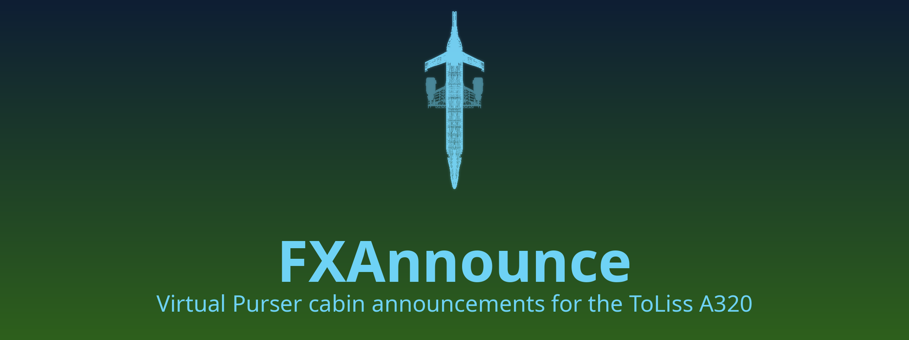

# Xnounce
<div align="center">


**Automatic cabin announcements for the ToLiss A319, A320 and A321 in X-Plane 12.**

<a href="https://www.x-plane.com/"></a>


</div>

Xnounce acts as a automatic purser announcement system. It plays the cabin announcements of community *Airline Packs* (made for the Fenix A320 in MSFS) at the right moments of the flight, without you pressing anything: boarding music and welcomes at
the gate, the safety briefing, cabin checks, cabin dimming, the after-takeoff and descent calls, and deboarding.

> [!NOTE]
> The plugin is still being tested in the simulator. Most Toliss signals that follow the  flight phases are verified (see *Known limitations*). If something plays at the wrong  time, please include the generated logfile in a bug report.

## Features
- **Auto Selection of Airline Packs**: Matches audio packs based on your livery, SimBrief plan, or MCDU flight number.
- **Flight tracking**: Reads ToLiss doors, signs, FMGS/ECAM, thrust levers, speedbrakes, and ACP knobs to determine the flight phase.
- **Dynamic boarding**: With SimBrief, boarding begins 30–40 minutes prior to departure. Without SimBrief, boarding triggers when a passenger door opens and scales realistically to your passenger count.`
- **Flight Phase aware announcements**: Follows Fenix logic to play the correct files based on aircraft type, time of day, refueling status, flight phase, and custom livery tags. Cabin crew take their seats for takeoff when landing lights or strobes are switched on, and for landing when the gear drops or the NO SMOKING sign is cycled.
- **Spatial audio**: PA announcements are muffled behind a closed cockpit door. Audio clears up if you open the door, move to the cabin, or pull the ACP PA knob. Respects ACP volume controls, ToLiss volumes, and exterior views.
- **Interactive cabin calls**: Cabin calls trigger the cockpit buzzer and wait for you to pull the ACP CAB knob to answer.
- **Pause sync**: Audio pauses and resumes perfectly with the simulator.

## Requirements
**Needed**
- X-Plane 12 (the window uses Panel Graphics on X-Plane **12.4.4-R1** and later, with an OpenGL fallback on older versions (NOT TESTED)).
- The ToLiss A319, A320 or A321 (CEO or NEO). ToLiss A320 NEO 1.3 and A321 CEO 1.8 or later are recommended.
- Airline Packs in the Fenix format. They are third-party content and **not included**. Put them in
  `X-Plane 12/Resources/plugins/AirlinePacks/`.

> [!TIP] 
> Use Announcement Hangar (Cabin Announcements For Fenix) to find and download Airline Packs for this plugin. This is a discord server that hosts Airline Packs for the Fenix A320 in MSFS. The packs are free to download.

**Optional**
- [simbrief_hub](https://github.com/hotbso/simbrief_hub) with your SimBrief Pilot ID. It supplies the plan (departure time, airline, flight number, passengers). Xnounce doesn't download anything itself.

## Install
1. Download the latest `Xnounce-x.y.z.zip` from the [Releases page](https://github.com/nacelle-sim/Xnounce/releases)
   and extract it. One zip works on Linux, Windows and macOS (Intel and Apple Silicon).
2. Copy both folders, `Xnounce` and `AirlinePacks`, into `X-Plane 12/Resources/plugins/`. If you already have an
   `AirlinePacks` folder, let them merge: nothing of yours is replaced.
3. Put your Airline Packs into `X-Plane 12/Resources/plugins/AirlinePacks/`. Each pack is a folder named with the
   airline's ICAO code (`DLH`, `BAW`…), plus an optional `Default` folder.
4. Start X-Plane and load a ToLiss A319, A320 or A321. If you add packs later, use the `xnounce/rescan` command.
5. Xnounce stays dormant on every other aircraft. The A330 and A340 are planned for a later version.

**Updating:** replace the `Xnounce` folder. Settings are kept.

**Coming from FXAnnounce (0.3.1 or older)?** Xnounce is the same plugin under its new name. Delete the old
`FXAnnounce` folder from `Resources/plugins/` and copy `Xnounce` in. Your settings are carried over on the first
start, and key bindings to the old `fxannounce/...` commands keep working.

**macOS:** the plugin isn't notarized by Apple. If X-Plane reports that Xnounce can't be opened or verified, run
this once in Terminal (adjust the path to your X-Plane folder), then restart X-Plane:
```
xattr -dr com.apple.quarantine "/Applications/X-Plane 12/Resources/plugins/Xnounce"
```

## Choosing a pack for a livery
In this order, the plugin goes:
1. **Per-livery file:** `airlinepack.cfg` in the livery folder:
   ```
   airline = BAW
   custom_tags = WiFi,USB
   overwater = no
   ```
2. **Central mapping:** `AirlinePacks/liveries.ini`, keyed by a pattern on the livery folder name:
   ```
   [British Airways*]
   airline = BAW
   ```
3. **SimBrief plan:** its callsign (such as `BAW123`), when the plan starts at this airport.
4. **Flight number** entered in the MCDU (`BAW123` or `BA123`).
5. **Livery folder name:** for example "Lufthansa (D-AIJB)" → DLH.
6. **`Default`** pack, if you have one.

Sounds from different packs are never mixed.

## Using it
- **Window:** Plugins → Xnounce → Show/hide window, or bind the `xnounce/window_toggle` command. It works on
  any aircraft; on one Xnounce doesn't support, Status says so.
  - **Status:** the cabin (stage, what plays now, what comes next), your SimBrief flight, and the aircraft, livery
    and Airline Pack.
  - **Timeline:** what comes next and the history of the flight. Untick *Timeline* in the titlebar to hide it.
  - **Packs:** what is playing (with Skip and Mute), the active pack, and every installed pack and file.
  - **Settings:** pages for announcements, sound, boarding, timing, ToLiss, display and advanced options. Changes
    apply at once.
  - **Log:** switch it on in Settings → Advanced → *Show log*. It also shows the live sim inputs and, on the Packs
    tab, an explanation of what would play now and why.
  - The *White / Dark* switch in the titlebar picks the theme.
- **Commands** (bind them in X-Plane's keyboard settings):
  - `xnounce/skip`: stop the current announcement.
  - `xnounce/advance`: fire the next event now.
  - `xnounce/mute_toggle`.
  - `xnounce/overwater_toggle`: enable `[Overwater]` announcements for this flight.
  - `xnounce/rescan`: look for new packs and files.
- **Boarding** starts by itself, in one of three ways:
  - with a SimBrief plan for this airport, 30–40 min before departure (longer for an A321 and for a fuller cabin),
    using X-Plane's clock;
  - if you load in after that time, or have no plan: 15 s after a passenger door is open at the gate with power on
    (also when ToLiss closed the door before you powered up);
  - at once when you press a cabin call button (FWD, AFT, ALL…) on the overhead CALLS panel at the gate.

  Settings → Announcements → **Boarding starts** can switch to doors only, or to cabin call only.
- **Boarding complete** comes when the boarding time is up: the Status tab counts it down. It comes sooner when you
  switch the beacon on, push back or start an engine, or press a cabin call during boarding (about 60 s later). The
  ToLiss doors don't end boarding: in AUTO they close on their own timer, and you can set them to OPEN or reopen them
  without changing anything.
  - If your SimBrief departure time is too close (SimBrief sets the off-block time 30 min after you start the dispatch
    unless you change it), boarding is shortened and the Status tab tells you. Set a later off-block time in
    SimBrief for a full boarding.
  - If the boarding time is more than an hour away, Xnounce assumes X-Plane's clock isn't set to your flight's
    time and boards when the doors open instead.
- **Departure:** the safety briefing starts 20–40 s after the aircraft starts moving (pushback, or taxi without a push).
  When the cabin check is done, the cabin reports "cabin secured" by interphone during the taxi. The call to take seats
  for takeoff, and the cabin dim at night, wait for your line-up signal:
  - landing lights ON (extended but OFF doesn't count);
  - strobe ON (AUTO doesn't count);
  - or a cabin call button once you are taxiing.

  Without a signal before takeoff thrust, the seats call is skipped.
- **Cabin calls and signs later on:**
  - before taxiing, or during the descent: a cabin call makes the cabin finish its safety check quickly;
  - after takeoff: a cabin call, or switching NO SMOKING off and on again within 10 s, tells the crew they may leave
    their seats, and the after-takeoff announcement plays;
  - before landing: once the cabin has reported "cabin secured", the seats call comes when the gear goes down or when
    you flick NO SMOKING.
- **SimBrief in flight:** after takeoff the Status tab follows the plan ("en route to LFMN, 312 NM", "returning to
  EDDM", "arrived at LFMN"). An OFP for your next leg can be loaded at any time; it is used once you are at its
  departure airport.
- **After the flight:** with Settings → Announcements → **Turnaround** off (the default), the flight is complete after
  deboarding. A new SimBrief plan from that airport, a new situation or a reload starts the next one. Switch
  Turnaround on to board the next leg at the same gate on its own.
- **Loaded with engines running?** Boarding is skipped. Shut the engines down at the gate to board.
- **Settings file:** `Output/preferences/Xnounce.ini`.
- **Log:** `Output/Xnounce.log`. Turn on **Record flight trace** to also write a CSV trace to `Output/Xnounce/`.
  Traces can contain your SimBrief or account details, so check them before you share them.

## What's new
See [CHANGELOG.md](CHANGELOG.md) for the changes in each version.

## Known limitations
- **Fenix names only.** Files must use Fenix announcement types: BoardingWelcome, BoardingComplete, ArmDoors,
  DisarmDoors, PreSafetyBriefing, SafetyBriefing, CrewTakeSeats, CabinDim, CabinSecured, AfterTakeoff, SeatbeltSignOn,
  SeatbeltSignOff, CabinService, DescentStarted, AfterLanding, DeboardingStarted, DeboardingComplete, Decompression
  and BoardingMusic. The Fenix legacy names also work: CrewSeatsTakeoff/Landing, CabinDimTakeoff/Landing,
  CallCabinSecureTakeoff/Landing, DescentSeatbelt(s), FastenSeatbelt and DisembarkStarted. Names from other tools
  (BoardingStarted, Turbulence…) are listed in the Packs tab with the Fenix name to rename them to, and are not
  played.
- **Phase estimate without FMGS.** If the FMGS isn't initialized, Xnounce estimates the flight phase from the
  aircraft's state. Short flights still get the main calls, but timing is less precise.
- **Overwater** is set per flight from the livery config, Settings → Announcements or the command, not from the route.
- **No changes to the aircraft.** Xnounce only reads ToLiss values and never writes to them.
- **A330 and A340** are not supported yet.

## Build from source
```
cmake -S native -B build -G Ninja
cmake --build build
cmake --build build --target xn_tests xn_ui_tests && ./build/xn_tests && ./build/xn_ui_tests
```
The plugin is written to `build/Xnounce/<platform>/Xnounce.xpl`. Releases are built by CI from a version
tag (`docs/ARCHITECTURE.md` § 6). Developers: see `docs/` for the behaviour
spec (`VP_SPEC.md`), the design (`ARCHITECTURE.md`), the ToLiss datarefs (`TOLISS_DATAREFS.md`) and the in-sim
checklist (`ACCEPTANCE.md`).

## Credits
- **Fenix Simulations:** the Airline Packs format and the cabin announcement rules that Xnounce follows. Xnounce
  is not affiliated with Fenix.
- **ToLiss:** the A319, A320 and A321 for X-Plane.
- **X-Airbus by FrankLFRS:** the names and value meanings of several ToLiss datarefs were checked against this FlyWithLua
  library. No code is copied from it.
- **simbrief_hub by hotbso:** the SimBrief plan interface.
- **B612** and **B612 Mono** by Airbus and Intactile Design, under the SIL Open Font License 1.1
  (`licenses/B612-OFL.txt`).
- **Dear ImGui, ImgWindow, libogg, libvorbis, doctest** and the **X-Plane SDK** (Laminar Research).
- Thanks to the Airline Pack makers for their packs.

## Agentic Coding Disclaimer
This project was developed with the assistance of Claude, an AI language model by Anthropic. 

What did Claude do? Pulled Toliss datarefs from the SDK, developed most of the code alongside a human developer, and integrated with X-Plane 12 imGUI and plugin development. Human oversight was provided throughout the development process, including code review, testing, and final decision making.

## License
Xnounce is licensed under the GNU General Public License v3.0 (see `LICENSE`).
Airline Packs and ToLiss aircraft are third-party content and are not included or covered by this license.
Xnounce is not affiliated with Laminar Research, ToLiss or Fenix Simulations.
